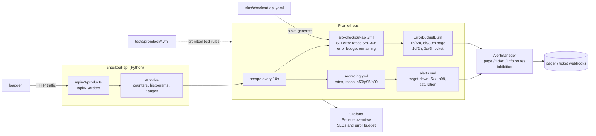

# prometheus-sre-observability

SRE observability for a Python checkout API, built on Prometheus. The service is instrumented with
the official `prometheus_client` library (RED metrics, saturation and business metrics). The repo
also holds recording and alerting rules, availability and latency SLOs with error-budget
tracking, multi-window multi-burn-rate alerts generated by a small SLO tool (`slokit`), Alertmanager
routing, two provisioned Grafana dashboards, and promtool unit tests that check each alert fires,
and stays silent, on synthetic series.

## Architecture



Detail: [docs/architecture.md](docs/architecture.md), SLO formulas: [docs/slo-math.md](docs/slo-math.md),
runbooks for every alert: [docs/runbooks.md](docs/runbooks.md).

## What is included

| Area | Files | Highlights |
|---|---|---|
| Instrumented service | `src/checkout_api/` | `http_requests_total{method,route,code}`, `http_request_duration_seconds` histogram with a 0.3 s bucket for the latency SLI, in-flight gauge, order outcomes, stock gauge, build info. Bounded route templates keep label cardinality low. Fault injection (`CHECKOUT_ERROR_RATE`, `CHECKOUT_SLOW_RATE`) |
| Prometheus config | `prometheus/prometheus.yml` | Example scrape config for the API, Prometheus and Alertmanager; metric relabelling; rule files |
| Recording rules | `prometheus/rules/recording.yml` | 9 rules following `level:metric:operations` naming |
| Alerting rules | `prometheus/rules/alerts.yml` | 7 symptom, saturation, business and self-monitoring alerts with severity and runbook links |
| SLO rules | `slos/checkout-api.yaml` turns into `prometheus/rules/slo-checkout-api.yml` | 99.9% availability and 99% under 300 ms over 30d; 22 recording and 8 burn-rate alert rules, generated |
| SLO tool | `src/slokit/` | Spec validation, rule generation with drift check, error budget / burn rate / time-to-exhaustion CLI |
| Rule unit tests | `tests/promtool/` | 11 test groups, 15 alert assertions, 11 PromQL assertions |
| Alertmanager | `alertmanager/alertmanager.yml` | Severity routing, page-over-ticket inhibition, placeholder webhooks |
| Dashboards | `grafana/dashboards/*.json`, `grafana/provisioning/` | Service overview (golden signals, heatmap, saturation, business) and SLO dashboard (SLI, budget remaining, burn rates per window, firing burn alerts) |
| Local stack | `docker-compose.yml`, `Dockerfile` | API, loadgen, Prometheus v3.16.0, Alertmanager v0.35.0, Grafana 13.3.1, bound to 127.0.0.1 |
| Python tests | `tests/test_*.py` | 98 pytest tests (SLO maths, spec validation, rule generation, instrumentation, HTTP server, CLI, cross-file consistency of rules/dashboards/runbooks/compose) |

## SLOs

| SLO | SLI | Objective (30d) | Error budget |
|---|---|---|---|
| availability | non-5xx `/api/*` responses / all `/api/*` responses | 99.9% | 0.1% of requests (43m12s of full outage) |
| latency | `/api/*` requests at or under 300 ms / all `/api/*` requests | 99% | 1% of requests |

```text
$ uv run slokit budget --objective 99.9 --window 30d
error_budget_ratio: 0.001
allowed_downtime: 43m12s
burn_rate_alerts:
  - severity=page, windows=1h/5m, burn_rate=14.4, error_ratio_threshold=0.0144, budget_consumed_pct=2.0, exhausts_full_budget_in=2d2h
  - severity=page, windows=6h/30m, burn_rate=6.0, error_ratio_threshold=0.006, budget_consumed_pct=5.0, exhausts_full_budget_in=5d
  - severity=ticket, windows=1d/2h, burn_rate=3.0, error_ratio_threshold=0.003, budget_consumed_pct=10.0, exhausts_full_budget_in=10d
  - severity=ticket, windows=3d/6h, burn_rate=1.0, error_ratio_threshold=0.001, budget_consumed_pct=10.0, exhausts_full_budget_in=30d
```

## Repository layout

```
src/checkout_api/     instrumented API (stdlib HTTP server + prometheus_client), loadgen
src/slokit/           SLO model, budget maths, rule generator, CLI
slos/                 SLO specs (source of truth for SLO rules)
prometheus/           prometheus.yml and rules/ (recording, alerts, generated SLO rules)
alertmanager/         routing and inhibition example
grafana/              dashboards JSON and provisioning (data source + dashboard provider)
tests/                pytest suites and tests/promtool rule unit tests
scripts/              fetch-tools.sh (promtool/amtool, checksum verified), validate-all.sh
docs/                 architecture, SLO maths, runbooks
```

## Setup and validation (no containers needed)

Requires Python 3.11+, [uv](https://docs.astral.sh/uv/), `curl`, and optionally ShellCheck and hadolint.

```bash
git clone https://github.com/shubhamkhedkar/prometheus-sre-observability.git
cd prometheus-sre-observability
uv sync --frozen                 # locked dependencies from uv.lock
make test                        # 98 pytest tests
./scripts/fetch-tools.sh         # promtool 3.16.0 + amtool 0.35.0 into ./bin (sha256 verified)
./scripts/validate-all.sh        # tests, ruff, yamllint, shellcheck, hadolint, SLO drift check,
                                 # promtool check config/rules, amtool check-config, promtool test rules
```

Individual targets: `make lint`, `make audit` (pip-audit), `make slo-check`, `make promtool-check`,
`make promtool-test`.

## Run the API on its own

```bash
uv run checkout-api serve --port 8080                         # 127.0.0.1 by default
curl -s localhost:8080/api/v1/products
curl -s -X POST localhost:8080/api/v1/orders -d '{"sku":"SKU-1002","quantity":1}'
curl -s localhost:8080/metrics | grep -E '^http_requests_total|^checkout_'
uv run checkout-api loadgen --target http://127.0.0.1:8080 --duration 60 --rate 20
```

## Run the full stack later (Docker Compose)

These steps start containers on your machine. They are not run by this repository.

1. `cp .env.example .env` and set `GRAFANA_ADMIN_PASSWORD` to a long random value. Compose refuses
   to start Grafana without it.
2. `docker compose up -d --build` builds `checkout-api:local` and starts the API, loadgen,
   Prometheus, Alertmanager and Grafana.
3. Open Prometheus at <http://127.0.0.1:9090> (Status > Targets: all `UP`, Alerts: all inactive),
   Grafana at <http://127.0.0.1:3000> (folder **checkout-api**), and Alertmanager at
   <http://127.0.0.1:9093>.
4. Exercise the alerts: set `CHECKOUT_ERROR_RATE=0.1` in `.env`, then
   `docker compose up -d checkout-api`. Within about 5 minutes `ErrorBudgetBurn` (1h/5m page) and
   `CheckoutAPIHighErrorRate` fire and the SLO dashboard shows the burn rate. Set it back to `0.0`
   and the page clears within minutes because the 5m short window recovers.
5. Latency: `CHECKOUT_SLOW_RATE=0.05` pushes 5% of requests past 300 ms, which burns the 99%
   latency SLO at 5x and opens the 1d/2h and 3d/6h tickets once their `for` durations pass.
6. To deliver alerts, replace the `example.invalid` webhook URLs in `alertmanager/alertmanager.yml`
   with your pager and ticketing integrations. Keep credentials in a secret store, not in Git.

## Changing an SLO

1. Edit `slos/checkout-api.yaml` (objective, SLI PromQL with `$window`, alert tiers).
2. `make slo-rules`, then review the diff of `prometheus/rules/slo-checkout-api.yml`.
3. Update `tests/promtool/slo_test.yml` if thresholds changed, and run `./scripts/validate-all.sh`.
   `make slo-check` (also a pytest test) fails when the generated file is stale.

No CI workflow is included and GitHub Actions is disabled on this repository. Wire
`scripts/validate-all.sh` into your own pipeline as a required check.

## Limitations

- Validated offline only. promtool and amtool check syntax and evaluate rules against synthetic
  series. No Prometheus, Alertmanager or Grafana server was started, and the dashboards were not
  rendered in Grafana (their JSON structure and PromQL metric references are unit tested).
- The Docker image and the compose stack are defined but were never built or run.
- `slo:sli_error:ratio_rate30d` evaluates a 30-day `rate()` every evaluation interval. That works
  at this scale; for large fleets, derive long windows from shorter recorded rates or use a
  dedicated SLO backend.
- Ratios over windows with no traffic evaluate to NaN, so burn alerts stay silent when there is
  no traffic. Pair them with `CheckoutAPIMetricsAbsent` / `CheckoutAPITargetDown`.
- Single-instance demo service: stock and orders live in memory and reset on restart.
- Alertmanager receivers are placeholders and deliver nowhere.

## Cleanup

Local validation creates nothing outside the repo: `make clean` removes `.venv/`, `bin/` and caches.
If you ran the stack: `docker compose down -v` removes the containers and the Prometheus and
Grafana volumes. Then `docker image rm checkout-api:local`.

## References and attribution

- [Prometheus](https://github.com/prometheus/prometheus) (Apache-2.0) by the Prometheus authors /
  CNCF. Its rule format, promtool unit-test format, naming conventions and documentation shaped
  this project. No Prometheus source code is copied; promtool and amtool are downloaded from the
  official releases at validation time and are not redistributed here.
- [prometheus/client_python](https://github.com/prometheus/client_python) (Apache-2.0), used as a
  dependency for instrumentation.
- The burn-rate tiers follow the Google SRE Workbook chapter
  [Alerting on SLOs](https://sre.google/workbook/alerting-on-slos/).
- [Grafana](https://github.com/grafana/grafana) dashboard JSON follows Grafana's public dashboard
  schema; Grafana is a trademark of Grafana Labs.

## License

MIT, see [LICENSE](LICENSE).
