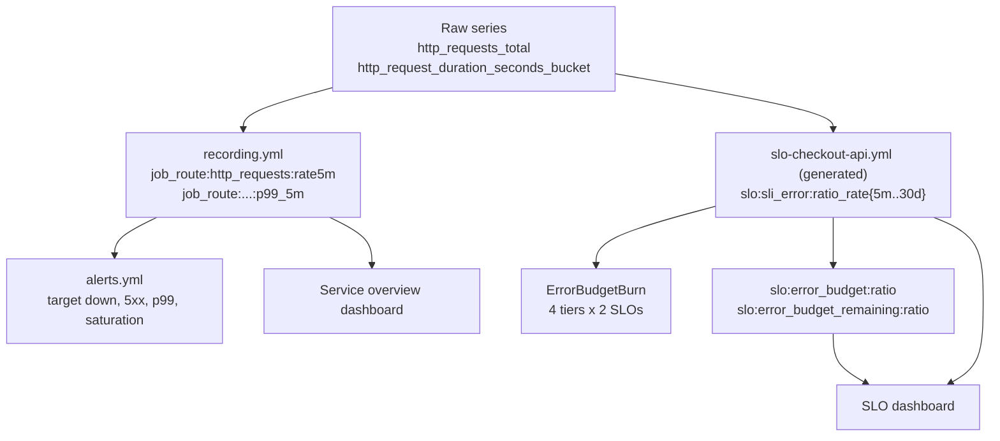

# Architecture

## Components

| Component | Role |
|---|---|
| `checkout-api` | Python HTTP service instrumented with the official `prometheus_client`; exposes `/metrics`, optional fault injection |
| `loadgen` | Same image, sends a read-heavy mix of product and order requests |
| Prometheus | Scrapes the API every 10s, evaluates recording rules, SLO rules and alerts |
| Alertmanager | Routes `page`, `ticket`, `info` severities; inhibits ticket burn alerts while a page burn alert fires |
| Grafana | Provisioned data source plus two dashboards (service overview, SLO/error budget) |
| `slokit` | Generates SLO recording and burn-rate alert rules from `slos/*.yaml`; budget maths CLI |

## Rule layers

## Change workflow

1. Edit `slos/checkout-api.yaml` (objective, SLI query, tiers).
2. `make slo-rules` regenerates `prometheus/rules/slo-checkout-api.yml`.
3. `make test promtool-check promtool-test` proves the rules parse and that the expected alerts
   fire (and stay silent) for synthetic series.
4. Review the diff of the generated file in the pull request, then reload Prometheus
   (`curl -X POST localhost:9090/-/reload` with `--web.enable-lifecycle`).
